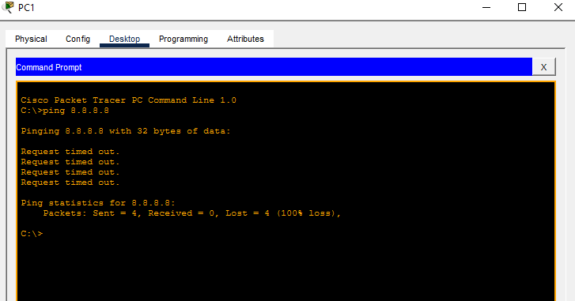
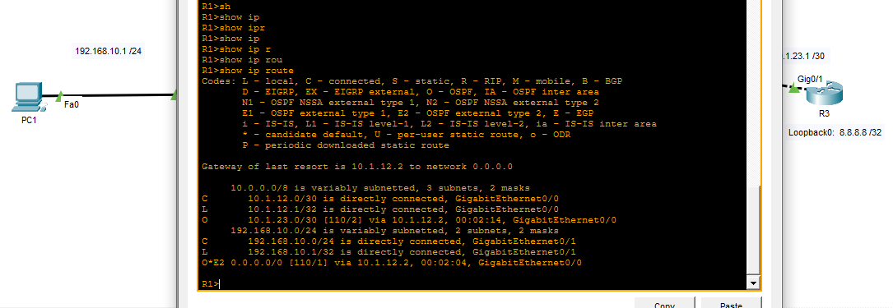

# Portfolio de Ingeniería de Redes | CCNA 200-301

## Laboratorio 04: Implementación de OSPFv2 Single-Area, Passive Interfaces y Redistribución de Ruta por Defecto

**Autor:** Rafael Andrés Ramírez Benavides  
**Rol:** Junior Network Engineer  
**Certificaciones en preparación:** Cisco Certified Network Associate (CCNA 200-301)  

---

### 1. Resumen Ejecutivo
Se diseñó e implementó una topología de red corporativa compuesta por tres routers (R1, R2, R3) utilizando el protocolo de enrutamiento dinámico OSPFv2 en un área única (Area 0). El objetivo principal consistió en garantizar la conectividad End-to-End desde la LAN de usuarios hasta la simulación de Internet (ISP), optimizar el procesamiento de CPU mediante interfaces pasivas y propagar automáticamente la ruta por defecto en el dominio OSPF.

---

### 2. Diagrama de Red y Esquema de Direccionamiento IP

```text
[ PC1: 192.168.10.10 ]
         | (LAN VLAN 10)
     [ R1 ] (Gi0/0/1)
         | 10.1.12.0/30
     [ R2 ]
         | 10.1.23.0/30
     [ R3 ] --- (Loopback0: 8.8.8.8/32 - Simulación ISP)
     | Dispositivo | Interfaz | Dirección IP / Máscara | Subred / Propósito |
| :--- | :--- | :--- | :--- |
| **R1** | Gi0/0/1 | `192.168.10.1 /24` | Gateway LAN Usuarios |
| **R1** | Gi0/0/0 | `10.1.12.1 /30` | Enlace Punto a Punto R1-R2 |
| **R2** | Gi0/0/0 | `10.1.12.2 /30` | Enlace Punto a Punto R1-R2 |
| **R2** | Gi0/0/1 | `10.1.23.2 /30` | Enlace Punto a Punto R2-R3 |
| **R3** | Gi0/0/1 | `10.1.23.3 /30` | Enlace Punto a Punto R2-R3 |
| **R3** | Loopback0 | `8.8.8.8 /32` | Internet / Salida WAN |

---

### 3. Tareas e Implementación Técnica

#### A. Asignación de Router IDs Estáticos y OSPF Area 0
Se definieron Router IDs fijos para estabilizar la selección de DR/BDR y evitar dependencia de las direcciones IP de las interfaces:
* `R1`: `1.1.1.1`
* `R2`: `2.2.2.2`
* `R3`: `3.3.3.3`

#### B. Endurecimiento de Seguridad y Optimización (Passive Interface)
Se configuró la interfaz `Gi0/0/1` de `R1` como `passive-interface` para prevenir la transmisión de paquetes OSPF Hello hacia el segmento LAN de los usuarios finales, reduciendo superficie de ataque y uso innecesario de ancho de banda.

#### C. Inyección de Ruta Predeterminada (`default-information originate`)
Se estableció una ruta estática predeterminada en `R3` apuntando hacia la interfaz de Loopback (ISP) y se propagó dinámicamente a través de OSPF al resto de la red.

---

### 4. Comandos de Verificación Clave

1. **Verificación de Vecindades OSPF:**
   `R2# show ip ospf neighbor`
   *Resultado esperado:* Estado `FULL/ -` o `FULL/BDR` con R1 y R3.

2. **Verificación de la Tabla de Enrutamiento en R1:**
   `R1# show ip route`
   *Evidencia clave:*
   * Rutas internas OSPF marcadas con `O` (AD 110).
   * Ruta por defecto externa recibida de R3 marcada con `O*E2` (OSPF External Type 2).

3. **Prueba de Conectividad End-to-End:**
   `PC1> ping 8.8.8.8` (Éxito en respuesta desde la interfaz de simulación de Internet).

---

### 5. Competencias y Aprendizajes Demostrados
* Configuración avanzada de OSPFv2 en formato CLI Cisco IOS.
* Gestión de métricas, distancias administrativas (AD 110) y tipos de LSA externos (Type 2).
* Aplicación de buenas prácticas de seguridad operativa en redes de acceso corporativas.
---
### 6. Evidencias de Ejecución (Packet Tracer)

**Prueba de Conectividad End-to-End (Ping desde PC1 a 8.8.8.8):**


**Tabla de Enrutamiento en R1 (Mostrando rutas OSPF y ruta por defecto O*E2):**

